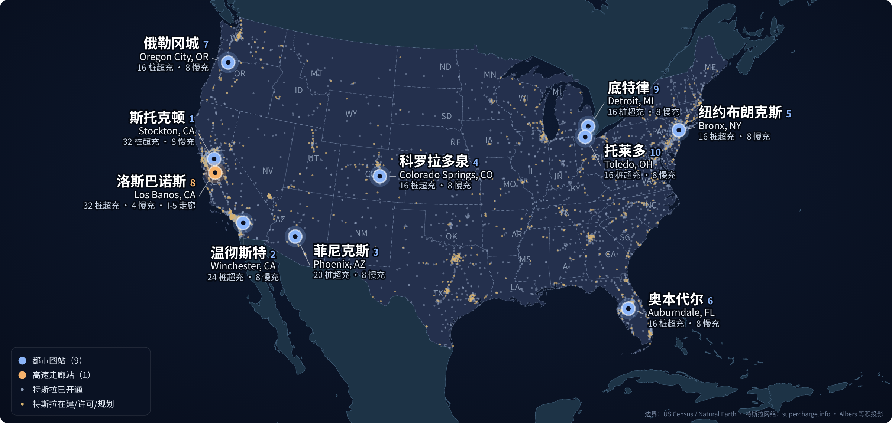
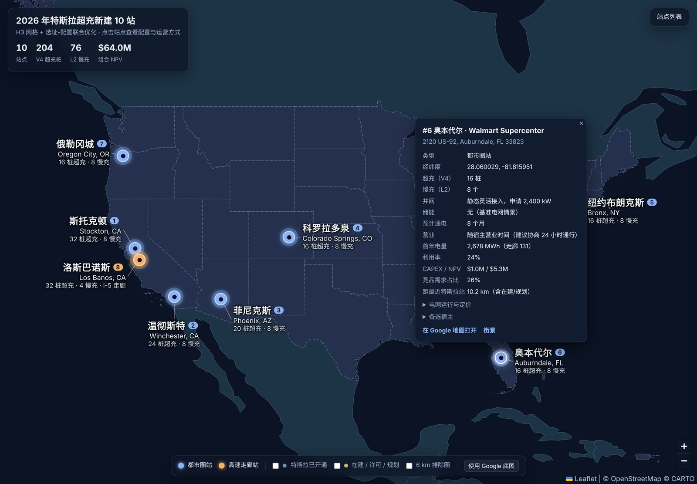

# 在美国给特斯拉超充选址：H3 网格 + 选址-配置联合优化 + 十年回测

用公开数据和 AI 协作，在美国本土挑出 **10 个优先新建的特斯拉超充站**，给到真实宿主地址、经纬度、超充/慢充配置、并网方式和运营方式，并用特斯拉 2016–2025 年的真实开站记录检验选址逻辑。



<sub>蓝点：都市圈站；橙点：I-5 高速走廊站；灰 / 黄小点：特斯拉已开通 / 在建·许可·规划站点（共 4,268 个）。所有推荐宿主距任何已开通或规划中的特斯拉站 ≥ 5.6 km。</sub>

**一句话结论**：10 个站、204 个 V4 超充桩 + 76 个目的地慢充，组合 NPV 约 **$64.0M**（模型估算，CAPEX $12.5M），首年服务电量约 36.5 GWh。选址信号在回测中都市圈 AUC **0.836**，前向验证中前 50 名有 **88%** 落在特斯拉自己当前的在建/规划站点 15 km 内。

📄 [两页提交报告（PDF）](outputs/特斯拉超充选址_提交报告.pdf) · 🗺️ [交互地图](web/index.html)（下载后双击打开）· 📚 [完整方法文档](docs/METHOD.md) · 📊 [10 站完整字段](outputs/final_10_sites.csv)

---

## 1. 背景与议题

特斯拉在美国已有约 3,300 个已开通、近 1,000 个在建或规划的超充站，NACS 统一后非特斯拉车辆也开始大量使用这张网。下一批站点该建在哪里，已经不是简单的"哪里人多、哪里空白"：

- **主干走廊基本补齐**。把在建和规划站计入后，只有约 4% 的候选网格还存在“舒适续航缺口”，问题从“补空白”变成“补容量”。
- **电网成了瓶颈**。常规并网要等 18–30 个月，馈线余量决定能建多大、多快通电。
- **竞争和自我分流同时存在**。新站会从竞品手里抢电量，也会分走特斯拉自己附近站点的电量。

所以我把它定义为一个**多目标、带电网约束的设施选址问题**：

| 目标 | 约束 |
|---|---|
| ① 路径可达与流量覆盖<br>② 降低里程焦虑与未覆盖风险<br>③ 投资回报与电网匹配（**权重最高，2/3**）<br>④ 少与竞品和特斯拉自有站互相分流 | a. 电网容量与并网条件<br>b. 土地与商业宿主可用性<br>c. 交通流、人口、经济活力与出行行为 |

## 2. 解决方案

```
公开数据 ─► H3 空间底座 ─► 需求与竞争建模 ─► 十年回测校准筛选 ─► 选址-配置联合优化（配置列 + 整数规划）─► 宿主尽调回路 ─► 10 站
```

| 步骤 | 做法 |
|---|---|
| **数据** | supercharge.info 全量特斯拉站（4,345 个美国本土站：开通日期、桩数、状态）；美国能源部 AFDC 竞品快充 12,558 站（2019/2022/2025 快照）；县人口、各州电动车保有量；Natural Earth 公路网；Google Places 宿主 |
| **H3 空间底座** | res-8 网格把路网连成图；res-6 网格（51,653 个）同时作为候选站点和路径弧段；res-4 汇总 738 个 OD 区。所有数据层用同一套网格编号关联 |
| **走廊需求** | 7,000 条重力模型 OD 最短路径上的加油流模型（FRLM）：间隔超过 320 km 可用续航则不可达，超过舒适续航计里程焦虑 |
| **本地需求** | MCI-Huff 引力模型：特斯拉站、竞品端口、外部选项三方竞争，带拥堵反馈和规模吸引力饱和，算出新站毛捕获和对特斯拉网络的净增量 |
| **筛选打分** | 都市圈用 14 个特征的逻辑回归（多尺度需求、Huff 捕获、周边特斯拉桩数、竞品、流量），走廊用回测校准的加权分量；按段、按州上限取 159 个候选 |
| **选址-配置联合优化** | 每个候选生成“桩数 8–48 × 并网方式（常规 / 静态灵活 / 动态灵活 / 过渡）× Megapack 0–2”的配置列，共 584 列；逐时运营模型（6 类代表日 × 24 小时）在灵活接入功率包络下调度，算 NPV、通电时间和限电损失 |
| **组合优化** | MILP 选 10 站：最大化 NPV，站距 ≥ 40 km、每州 ≤ 3、距任何特斯拉站 ≥ 6 km；对走廊服务电量做 ε-约束扫描得到帕累托前沿，按“利润 2/3 + 走廊 1/3”选点 |
| **尽调回路** | 每个网格找真实宿主；不满足土地或距离条件的网格剔除后重解（例：北拉斯维加斯网格贴着内利斯空军基地，被剔除） |

**迭代链条**：搭框架 → v0 单模型（都市圈≈人口基线，走廊几乎找不到）→ 都市圈 / 走廊分段 + 滚动重校准 → 经济性修正（吸引力饱和、区域电价、州上限）→ 尽调回路 → 对照“需求/供给^0.5”启发式（AUC 仅 0.63，选点落到海上、山顶）→ 学习型都市圈筛选（AUC 0.757 → 0.836）→ v2 重跑，换 4 站。

**人机分工**：我负责定义问题、设目标权重和业务规则、判断每轮结果是否合理并决定迭代方向；AI（Claude）负责前沿检索、数据获取清洗、写代码、跑回测和消融实验、搜宿主、做地图和报告。

## 3. 结果：10 个推荐站点

| # | 城市 | 类型 | 宿主 / 地址 | 纬度, 经度 | V4 超充 | L2 慢充 | 并网方式 | 首年 MWh | NPV $M |
|---|---|---|---|---|---|---|---|---|---|
| 1 | 斯托克顿, CA | 都市圈 | CA Stop Gas Station<br><sub>2224 Manthey Rd, Stockton, CA 95206</sub> | 37.92558, -121.29540 | 32（2 拖挂） | 8 | 动态灵活接入 | 7,034 | 11.7 |
| 2 | 温彻斯特, CA | 都市圈 | Boulder Crossing<br><sub>32873 Domenigoni Pkwy, Winchester, CA 92596</sub> | 33.69631, -117.08753 | 24 | 8 | 动态灵活接入 | 5,500 | 9.1 |
| 3 | 菲尼克斯, AZ | 都市圈 | Arizona Center<br><sub>455 N 3rd St, Phoenix, AZ 85004</sub> | 33.45250, -112.06890 | 20 | 8 | 静态灵活接入 | 3,949 | 8.1 |
| 4 | 科罗拉多泉, CO | 都市圈 | First & Main Town Center<br><sub>3305 Cinema Point, Colorado Springs, CO 80922</sub> | 38.88092, -104.71642 | 16 | 8 | 静态灵活接入 | 3,505 | 7.3 |
| 5 | 纽约布朗克斯, NY | 都市圈 | Concourse Plaza<br><sub>200 E 161st St, Bronx, NY 10451</sub> | 40.82522, -73.92028 | 16 | 8 | 静态灵活接入 | 3,694 | 6.6 |
| 6 | 奥本代尔, FL | 都市圈 | Walmart Supercenter<br><sub>2120 US-92, Auburndale, FL 33823</sub> | 28.06003, -81.81595 | 16 | 8 | 静态灵活接入 | 2,678 | 5.3 |
| 7 | 俄勒冈城, OR | 都市圈 | Oregon City Shopping Center<br><sub>1900 McLoughlin Blvd, Oregon City, OR 97045</sub> | 45.36881, -122.60003 | 16 | 8 | 静态灵活接入 | 2,451 | 4.6 |
| 8 | 洛斯巴诺斯, CA | 高速走廊 | Shell<br><sub>24729 Mercey Springs Rd, Los Banos, CA 93635</sub> | 36.92979, -120.84161 | 32（4 拖挂） | 4 | 动态灵活接入 | 3,550 | 4.1 |
| 9 | 底特律, MI | 都市圈 | Merchant Row Commons<br><sub>Livernois Ave at W Davison, Detroit, MI 48238</sub> | 42.39285, -83.14056 | 16 | 8 | 静态灵活接入 | 2,272 | 4.1 |
| 10 | 托莱多, OH | 都市圈 | Kroger<br><sub>2555 Glendale Ave, Toledo, OH 43614</sub> | 41.61141, -83.60637 | 16 | 8 | 静态灵活接入 | 1,862 | 3.0 |

每站的申请功率、通电月数、利用率、CAPEX、竞品需求占比、备选宿主、电网运行策略和定价见 [`outputs/final_10_sites.csv`](outputs/final_10_sites.csv)。

**运营方式**
- 对所有 NACS 车辆开放，特斯拉 / 非特斯拉、会员 / 非会员差异定价。
- 分时电价引导错峰；占用率超过 80% 启用拥堵费，充满后收占位费。
- 动态灵活接入的站点按电力公司逐时功率包络运行，限电时降低单桩功率而不关桩，优先低电量车辆。
- 走廊站设 4 个拖挂直通车位，节假日高峰启用预约与 80% SOC 上限。

**经济增效**
- **灵活接入**：通电时间从常规的 18–30 个月缩到约 8 个月；与 10 站全部走常规接入相比，组合 NPV 高约 29%（$64.0M 对 $49.6M）。
- **按 NPV 定规模**：16–32 桩而不是一律做大；基准情景下不需要 Megapack，只在馈线余量不足时追加。
- **帕累托取舍**：比纯利润最优少 9% NPV，换来走廊服务电量翻倍（4.6 → 9.3 GWh/年）。



<sub>交互地图 `web/index.html`：全屏深色底图、站点中英文标注，点击弹出配置、并网和经济指标，并可跳转 Google 地图与街景；可叠加特斯拉现有网络和 6 km 排除圈。填入 Google Maps API key 可切换为 Google 底图。</sub>

## 4. 效果评估

**回测设计**：2016–2025 年，每年 1 月 1 日只用当时可见的特斯拉网络和竞品快照给 51,653 个候选网格打分，对照当年真实开站；2019–2025 年滚动样本外，每年只用过去的数据重新校准。

| 滚动样本外 2019–2025 | AUC | 命中率\* | 随机命中率 |
|---|---|---|---|
| 都市圈（学习型筛选，v2） | **0.836** | 0.78 | 0.28 |
| 都市圈（只看需求，对照） | 0.751 | — | — |
| 都市圈（需求/供给^0.5 启发式，对照） | 0.632 | 0.56 | 0.28 |
| 高速走廊 | 0.673 | 0.31 | 0.15 |

<sub>\*前 K 名（都市圈 35、走廊 15）中，当年或次年在 15 km（走廊 25 km）内出现特斯拉新站的比例。学习型筛选连续 7 年 AUC 均高于“只看需求”。</sub>

**前向验证**：只用已开通网络打分，看前 K 名是否落在特斯拉当前在建/许可/规划站点附近，模型完全没见过这部分数据。都市圈前 50 名 **88%**（随机 38%），走廊前 30 名 23%（随机 10%）。

**还不确定、需要线下确认的**
- **NPV 绝对值**依赖需求、电价假设，没有公开的单站利用率数据可以校准；排序比金额更可信。
- **电网余量**是情景值。压力测试显示余量只有假设的 30% 时，FL、MI、OR 各需加 1 台 Megapack，AZ 要改为等电网升级，需向当地电力公司调承载能力图核实。
- **宿主**：温彻斯特 Boulder Crossing 是新建商业中心，要确认空地块；Walmart 在自建快充，谈判有变数；Kroger 需谈夜间通行；Merchant Row Commons 规模偏小（备选 Greenfield Center）。

## 5. 展望

- **把假设换成数据**：接入电力公司承载能力图（ICA/HCA）、真实充电利用率与交易数据、POI 与地块、交通计数，逐步替换情景参数。
- **拆解更多玩家**：把同一套回测框架用到 Electrify America、Ionna、Walmart、Buc-ee's 等，看各自的选址偏好和网络空白。
- **分场景定制模型**：按都市圈 / 走廊 / 气候区 / 电价区跑消融实验，为不同地理位置选择不同特征和超参数。
- **从选址到运营**：把逐时运营模型扩展到动态定价、储能调度和需求响应，评估站点全生命周期收益。
- **沉淀成可复用工具**：数据更新、回测、选点、尽调、出图出报告做成可复用的代码 / skill / harness，新区域、新问题可以快速复跑。

---

## 快速开始

```bash
pip install -r requirements.txt
./download_data.sh          # 下载较大的公开数据（路网约 50 MB）
python run_all.py           # 复用缓存，几分钟
python run_all.py --fresh   # 全部重算（回测约 15–20 分钟）
```

交互地图：直接用浏览器打开 `web/index.html`。PDF 报告：`python src/make_report.py`（需要 `playwright install chromium`）。

## 仓库结构

```
src/            全流程代码：数据准备 → H3 路网 → 需求模型 → 回测 → 选点（配置列 + MILP）→ 宿主 → 报告 / 地图
data/raw/       原始公开数据（特斯拉站点压缩导出、AFDC 竞品网格、人口、行政边界）
data/processed/ 清洗后的中间数据（大体积缓存不入库，run_all.py 会重新生成）
outputs/        回测、帕累托前沿、配置列、最终 10 站、敏感性分析、PDF 报告
web/            交互地图（index.html + 数据）
docs/           完整方法文档 METHOD.md 与图片
```

> 说明：这是用公开数据和显式假设搭建的方法原型，不代表特斯拉内部数据或决策。全部假设集中在 [`src/config.py`](src/config.py)，修改后可一键重跑。
